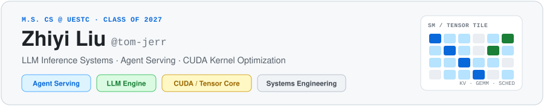
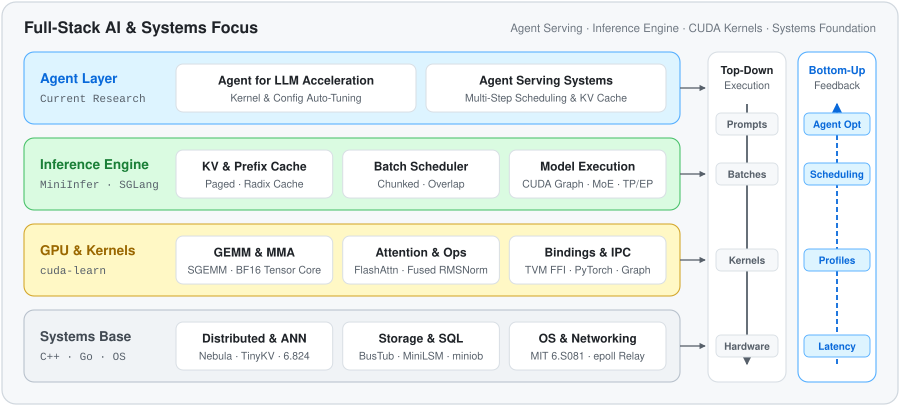

  <picture>
    <source media="(prefers-color-scheme: dark)" srcset="./assets/banner-dark.svg" />
    <source media="(prefers-color-scheme: light)" srcset="./assets/banner-light.svg" />
    
  </picture>

  
  
  
  

### 👋 Hi, I'm Zhiyi Liu

- 🎓 M.S. in Computer Science at **UESTC** (Class of **2027**).
- ⚡ Focusing on **LLM Inference Systems**, **Agent Serving Systems**, and **Agent-Driven System Optimization**.
- 📫 [tomlzy213@gmail.com](mailto:tomlzy213@gmail.com) · 🌐 [tom-jerr.github.io](https://tom-jerr.github.io/)

 

---

## 🧠 Research & Systems Stack

  <picture>
    <source media="(prefers-color-scheme: dark)" srcset="./assets/systems-stack-dark.svg" />
    <source media="(prefers-color-scheme: light)" srcset="./assets/systems-stack-light.svg" />
    
  </picture>

**Current research direction (ongoing work):**

- **Agent for LLM Engine Acceleration** — Exploring agentic workflows to automate kernel/system optimization, configuration tuning, and end-to-end inference acceleration.
- **Agent Serving Systems** — Designing system-level scheduling, KV cache management, and execution pipelines tailored for dynamic, multi-step agentic workloads.

---

## ⚡ LLM Engine & CUDA

| Project | Focus & Highlights |
| :--- | :--- |
| **[MiniInfer](https://github.com/tom-jerr/MiniInfer)** | Lightweight LLM inference engine built from scratch: Paged & Radix KV Cache, Continuous Batching, Chunked Prefill, Overlap Scheduling, Breakable CUDA Graph, FlashAttention2 / FlashInfer, Qwen2/3 & MoE, TP/EP execution. |
| **[cuda-learn](https://github.com/tom-jerr/cuda-learn)** | Handwritten CUDA kernels (SGEMM, BF16 Tensor Core MMA, FlashAttention, Fused RMSNorm, Softmax, SiLU-and-Mul, Top-K, Parallel Prefix Sum, CUDA Graph/IPC) exposed via TVM FFI + PyTorch bindings and benchmarked against cuBLAS / cuDNN. |
| **[SGLang](https://github.com/tom-jerr/sglang)** | Production LLM serving exploration covering Chunked Prefill, mixed scheduling, Breakable CUDA Graph, Speculative Decoding, and Radix Cache. |

---

## 🛠️ Systems Engineering

| Area | Projects & Scope |
| :--- | :--- |
| **Vector & Graph DB** | **[Nebula Graph — ANN Search](https://github.com/tom-jerr/nebula)** — Added native Approximate Nearest Neighbor (ANN) vector search to a distributed C++ graph database (indexing, query execution, storage optimization). |
| **Distributed Systems** | **[6.824](https://github.com/tom-jerr/system_design)** (Shard KV with distributed transactions in Go), **[TinyKV](https://github.com/tom-jerr/tinykv)** (Raft-based distributed KV store & transactions). |
| **Storage & Databases** | **[BusTub](https://github.com/tom-jerr/bustub)** (RDBMS execution & concurrency), **[miniob-exp](https://github.com/tom-jerr/system_design)** (vectorized engines, MVCC/OCC transactions, full SQL execution pipeline), **[MiniLSM](https://github.com/tom-jerr/MiniLSM)** (LSM-Tree storage engine). |
| **OS & Networking** | **MIT 6.S081** (xv6 OS kernel labs), **MIT 6.824 MapReduce** (C++ / gRPC distributed implementation), **RelayServer** (high-performance `epoll` network relay server). |

---

## 🧰 Tech Stack

  
  
  
  
  
  
  

---

## 📊 GitHub Activity & Stats

  <picture>
    <source media="(prefers-color-scheme: dark)" srcset="https://github-readme-stats.vercel.app/api?username=tom-jerr&show_icons=true&hide_border=true&theme=github_dark&bg_color=00000000" />
    <source media="(prefers-color-scheme: light)" srcset="https://github-readme-stats.vercel.app/api?username=tom-jerr&show_icons=true&hide_border=true&theme=default&bg_color=00000000" />
    
  </picture>
  <picture>
    <source media="(prefers-color-scheme: dark)" srcset="https://github-readme-stats.vercel.app/api/top-langs/?username=tom-jerr&layout=compact&hide_border=true&theme=github_dark&bg_color=00000000" />
    <source media="(prefers-color-scheme: light)" srcset="https://github-readme-stats.vercel.app/api/top-langs/?username=tom-jerr&layout=compact&hide_border=true&theme=default&bg_color=00000000" />
    
  </picture>

  <picture>
    <source media="(prefers-color-scheme: dark)" srcset="https://raw.githubusercontent.com/tom-jerr/tom-jerr/output/github-contribution-grid-snake-dark.svg" />
    <source media="(prefers-color-scheme: light)" srcset="https://raw.githubusercontent.com/tom-jerr/tom-jerr/output/github-contribution-grid-snake.svg" />
    
  </picture>

